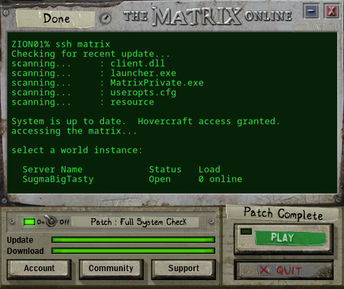
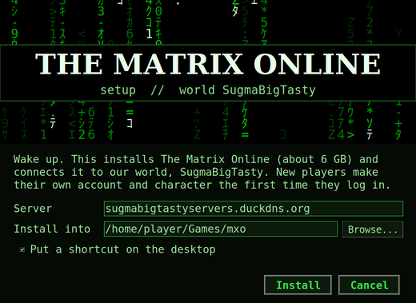

# The Matrix Online: Sugma Big Tasty world

**Wake up. The Matrix Online is back online.** This is a one-click installer and launcher for our community
server, running the open-source [Hardline Dreams](https://github.com/hdneo/mxo-hd) emulator. It works on Windows
and Linux.

- **No sign-up page.** Type a new username and password at the game's login screen and your account is made on the spot.
- **Make your own character.** Body, face, hair and clothes are all chosen in the game's own character creator.
- **The real 2005 launcher look.** The launcher is rebuilt from the original launcher's own skin, buttons, sounds
  and ZionOS terminal, which it reads from your game files. It runs a quick system check, shows the world's
  status, and PLAY takes you in.
- **No game files are in this repository.** The installer downloads the community MxO client (7.6005, 1.3 GB, from
  [files.mxoemu.info](https://files.mxoemu.info/)), or uses a copy you already have.

> **Use a password you don't use anywhere else.** The emulator stores passwords the way the 2005 game did
> (unsalted MD5), which is not modern-grade security.

## Install

Download the latest **[release](../../releases/latest)** for your system and unzip it.

### Windows

1. Double-click **`Install The Matrix Online.bat`**. Windows asks for admin rights once, so the game can go into
   any folder you pick.
2. Pick the folder and click **Install**. Leave the Server box as it is.
3. Play with the **The Matrix Online** shortcut. Graphics settings: **The Matrix Online Settings**.

The installer builds `MxO Launcher.exe` on your PC from the C# source in `windows/launcher` (with the compiler
that ships with Windows), so there is no pre-built program to trust.

### Linux

1. Double-click **Install The Matrix Online**, or run `./install-mxo-linux.sh`.
2. It needs Wine (GE-Proton is used when Steam or Lutris has it), 7-Zip, and python3 with Tk for the setup window
   and launcher (`tk` on Arch, `python3-tk` on Debian and Ubuntu).
3. Play from your app menu or desktop.

## What works

This is an emulator rebuilt by fans, not the original servers. You can log in, create characters, walk the city
districts, chat and use hardlines. Combat, missions and progression are limited or missing. Expect bugs. The
server is watched over by its admins.

## Already have MxO 7.6005?

Put `MxO_7.6005.7z` next to the installer and it skips the download. The installer never changes your
`launcher.exe`. It makes a separate copy, `MatrixPrivate.exe`, that carries our server's public key
(`server/signPub.dat`), plus a `useropts.cfg` that points the game at our server name.

## Files

| File | What it is |
|---|---|
| `windows/Install-MXO.ps1` | Windows installer (themed window, client download and unpack, key, launcher build, shortcuts) |
| `windows/launcher/*.cs` | The Windows launcher source: original skin, read from `launcher.exe` |
| `install-mxo-linux.sh` | Linux installer: Wine prefix, DXVK, shortcuts |
| `launcher/*.py` | The Linux setup window and launcher (python3 + Tk) |
| `mxo-installer.conf` | Our server: `DNS=` name and `WORLD=` |
| `server/signPub.dat` | Our server's public signing key (public, not a secret) |

## Credits

The Matrix Online was made by Monolith Productions and published by Warner Bros. / Sony Online Entertainment, and
it remains theirs. The server runs [Hardline Dreams](https://github.com/hdneo/mxo-hd) (MIT). The client package comes
from the [MxOemu](https://mxoemu.info/) community. The installer and launcher code here is MIT-licensed (see `LICENSE`).
